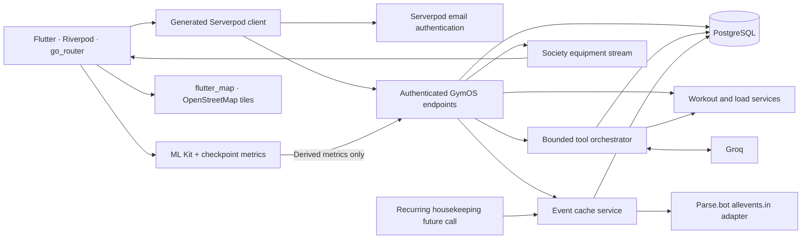

# GymOS 2.0

GymOS 2.0 is a community fitness app for residents and shared gyms. Members can find available equipment, create workouts suited to their goals and recent training, log sets and progress, check exercise form from still photos, and join local fitness events. Admins manage the gym's equipment, maintenance reports, members, and events.

**Flutter** provides the mobile and web interface, including workout tracking, OpenStreetMap event discovery, and on-device pose analysis for photo form checks. **Serverpod** provides the Dart backend: email authentication, typed client/server endpoints, PostgreSQL persistence for members and fitness data, live equipment updates, event caching, and the server-side AI coach integration. The app can run on a local Wi-Fi network; public cloud hosting has not been set up.

This local development build has passing backend/database and Flutter tests, a live authenticated workout/event flow, live Groq tool-based draft creation, cached external fitness listings (allevents.in via the Parse.bot wrapper), an admin dashboard with member management, in-app notifications, progress trends, and a redesigned dark interface. Physical-device photo verification and cloud deployment remain incomplete. See [agent.md](agent.md) for current evidence and remaining work.

Watch the [3:49 Android feature walkthrough](video/GymOS-2.0-mobile-walkthrough.mp4) for a caption-led tour of the main user and admin flows.

## Run your own copy (another computer)

Anyone can run GymOS on their own computer and Wi-Fi. They only need [Flutter](https://docs.flutter.dev/get-started/install) (it includes Dart) and, for the AI coach, a free Groq API key.

```bash
git clone https://github.com/Dinesh373737/GYMOS-Flutter.git
cd GYMOS-Flutter
dart tool/setup.dart
```

The setup script creates `gymos2/gymos2_server/config/passwords.yaml` with fresh local secrets, asks for the optional `GROQ_API_KEY` and `ALLEVENTS_API_KEY` (press Enter to skip either), fetches packages, and builds the web app. Then start the server with `start-gymos-server.cmd` (Windows) or `./start-gymos-server.sh` (macOS/Linux) and open `http://localhost:8082`. The first start downloads a private PostgreSQL. Sign-up verification codes are printed in the server window.

Without a Groq key everything works except the "Ask GymOS" coach; without a Parse.bot key, Discover shows community events only. Other devices on the same Wi-Fi can open `http://<computer IP>:8082`, or install the APK below and enter `<computer IP>:8080` under "Server · Change".

## Install on an Android phone

1. On the computer, double-click [`start-gymos-server.cmd`](start-gymos-server.cmd) (or run `dart run bin/main.dart --apply-migrations` in `gymos2/gymos2_server`) and keep that window open.
2. On the phone, download and open [`releases/GymOS-2.0.0-android-arm64.apk`](releases/GymOS-2.0.0-android-arm64.apk) (almost all phones). For older 32-bit phones use [`releases/GymOS-2.0.0-android-armv7.apk`](releases/GymOS-2.0.0-android-armv7.apk). Allow "install unknown apps" for your browser or file manager when Android asks.
3. Keep the phone on the same Wi-Fi as the computer and sign in.

The APK is built to reach `http://192.168.0.123:8080/`, the development computer's address on its home Wi-Fi. If that address changes, or you use another computer, tap **Change** next to "Server" on the sign-in screen (also under Profile → Server address) and enter the computer's IP and port, for example `192.168.0.50:8080`. The app works only while the server is running and reachable; it does not work over mobile data until the backend is deployed. It is signed with a debug certificate for sideloading, not for the Play Store.

To rebuild with a different default address, from `gymos2/gymos2_flutter`:

```powershell
flutter build apk --release --split-per-abi --dart-define=SERVER_URL=http://YOUR_COMPUTER_IP:8080/
```

## Download the web app

A ready-built release of the website is in [`releases/gymos-web.zip`](releases/gymos-web.zip). It needs the GymOS Serverpod backend running; `HOW-TO-RUN.txt` inside the zip explains both ways to serve it.

## Project layout

```text
original-daa/                 Preserved original repository/history (local)
gymos2/
  gymos2_server/              Endpoints, services, models, migrations
  gymos2_client/              Generated typed client; do not edit manually
  gymos2_flutter/             Flutter app and on-device pose processing
releases/                    Built web release zip and Android APKs
start-gymos-server.cmd       Starts the backend on Windows
requirements-reference.txt   Older extracted specification (see the .docx)
agent.md                     Implementation and verification record
```



## Available features

- Email sign-up/sign-in, society onboarding, private profiles, and admin/resident checks.
- Admin dashboard: member/equipment/maintenance/event aggregates, 14-day community activity, member role and pause controls (a society always keeps one active admin).
- In-app notifications for maintenance reports, resolutions and membership changes, with an unread badge.
- Responsive dark interface for Home, Workout, Form, Discover, Profile, Progress, Admin, equipment, and the coach, built on one design system (`app/theme.dart`, `core/widgets.dart`).
- Plans using goal, duration, focus, experience, equipment, recent load/frequency, and form attention history, with goal-specific set/rep targets.
- Workout start/resume, individual set persistence/editing/removal, last-session reference, in-session swaps, completion summary, history, and progress/load summaries.
- Progress trends: daily training-load estimate, per-exercise top weight/volume, week streak, and form-check history per checkpoint.
- Plans rank recently skipped exercises lower and say so in the rationale.
- Equipment management, maintenance reporting/resolution, and streamed equipment updates.
- Server-side Groq tool calling with persisted conversations and action logs.
- Squat, push-up, plank, and biceps curl photo checkpoints. Capture/inference requires Android or iOS; saved history works on web.
- Community events, categories, participation/capacity, a "Going" filter, directions, optional location, and a dark OSM map with distinct community and external markers.
- External fitness listings for London, New York and Tokyo, cached server-side and labeled live, cached, stale or unavailable.

Serverpod supplies authentication, typed client calls, PostgreSQL models/migrations, tenant-aware endpoints, streaming, and a recurring future call (`HousekeepingFutureCall`, every 6 hours) that refreshes expired external-event caches and prunes old records. Storage providers are configured, but the current app does not upload photos.

## Local setup

Use the existing Flutter, Dart, Git, and Serverpod installations. The workspace resolves Serverpod 4.0.3 and declares Dart `^3.12.2`. No toolchain upgrade is required by these instructions.

From the repository root, resolve packages:

```powershell
Set-Location gymos2
flutter pub get
```

Keep Serverpod's generated authentication/database secrets in `gymos2/gymos2_server/config/passwords.yaml`, which is ignored. Preserve its JWT, email, and database configuration. Never put real values into this README or tracked source.

| Setting | Configuration | Behavior |
| --- | --- | --- |
| `GROQ_API_KEY` | Serverpod password entry, with server environment fallback | Required for coach responses |
| `GROQ_MODEL` | Server environment | Defaults to `openai/gpt-oss-120b` |
| `SERVER_URL` | Flutter `--dart-define` | API override for devices/deployed builds |
| `OSM_TILE_URL` | Optional Flutter `--dart-define` | Overrides the default official OSM tile URL for a future suitable host; no map API key is required |
| `ALLEVENTS_API_KEY` | Serverpod password entry, with server environment fallback | Parse.bot key for the third-party allevents.in wrapper; without it Discover shows community events and a "not connected" label |
| `EXTERNAL_EVENTS_CACHE_TTL_MINUTES` | Server environment | External listing cache lifetime, 15–1440, default 360 |

From `gymos2/`, start the normal development workflow:

```powershell
serverpod start
```

Configured ports are API 8080, Insights 8081, web 8082, and development PostgreSQL 8090. The server package declares its companion Flutter app. Development email verification codes are written to the local server console by the configured Serverpod provider.

**Windows database setup:** development config declares embedded storage at `.serverpod/development/pgdata`. Test config uses a separately bootstrapped PostgreSQL cluster at `localhost:9090` with database `gymos2_test`; the real database integration test has passed against that setup. Ensure this test cluster is running before integration tests. Do not delete data directories as a routine startup fix.

On this Windows setup, use the Serverpod 4.0.3 bundled executable if the launcher wrapper fails:

```powershell
# From gymos2/, with the bundled serverpod.exe on PATH
serverpod.exe start --no-tui --no-flutter --no-watch
```

This command started development and applied the generated migrations. Launch Flutter separately when using `--no-flutter`. Stop the development server before backend tests: simultaneous execution caused a Windows `argon2.dll` file lock.

Inspect/restart the existing test cluster with the cached PostgreSQL tools, from the repository root:

```powershell
$pgCtl = Join-Path $env:LOCALAPPDATA 'serverpod/Cache/pg-binaries/16.13.0-r1/windows-x64/bin/pg_ctl.exe'
$testPgData = (Resolve-Path 'gymos2/gymos2_server/.serverpod/test/pgdata').Path
$testPgLog = Join-Path (Split-Path $testPgData) 'postgres.log'
& $pgCtl status -D $testPgData
# Only if status reports that this existing cluster is stopped:
& $pgCtl start -D $testPgData -o '-p 9090 -h localhost' -l $testPgLog
```

Do not initialize or recreate this existing cluster. A fresh checkout needs a separately provisioned test database matching `config/test.yaml` and its ignored password configuration.

For a physical Android device, run this from `gymos2/gymos2_flutter/`, substituting the computer's reachable API address:

```powershell
flutter run --dart-define=SERVER_URL=http://YOUR_COMPUTER_IP:8080/
```

Use a reachable HTTPS API for production. Android has camera/location permissions and uses Flutter's configured minimum SDK. Release builds allow cleartext HTTP so phones can reach a development server on the local network; use an HTTPS server and remove `usesCleartextTraffic` for production. Release signing still uses debug signing and needs production setup. The embedded map uses keyless OSM tiles on Android and Web; it needs no Google Maps SDK setup.

## Database and demo data

Models are in `gymos2_server/lib/src/models/*.spy.yaml`; three generated migrations are present (the third clears the disposable external-event cache before adding its unique index). Use the Serverpod development/MCP migration workflow when available; startup applies pending migrations. Regenerate from models/endpoints instead of editing generated code. When the supervised workflow cannot start, the documented fallback is `serverpod generate` and `serverpod create-migration` from the server package.

The catalog seeds on first successful onboarding. Creating a demo society creates an admin membership and:

- 44 catalog exercises and 20 catalog equipment types.
- 15 society equipment entries, including a cable machine under maintenance.
- Three labeled demo events near a demonstration Bengaluru location.

There are no fixed demo credentials or invite code. Create accounts with email auth; Profile displays the generated society invite code. A second account uses it to join as a resident. History starts empty and fills with actual logged workouts. Demo events are explicitly described as demonstrations, not live activities.

## Coach architecture

Flutter sends a message to `AgentEndpoint`. `AgentService` provides an allowlisted tool schema to Groq, executes requested tools against authenticated services, returns tool results, and persists the final message and safe action status/duration records. Each turn is capped at eight tool calls. Replacements require explicit replace/swap/substitute intent; there are no tools to delete history or change admin equipment data.

Tools: `get_user_profile`, `get_recent_workouts`, `get_training_readiness`, `get_available_equipment`, `search_exercises`, `get_exercise_alternatives`, `get_form_history`, `get_progress_summary`, `search_events`, `create_workout_draft`, `replace_workout_exercise`, and `explain_recommendation`.

The model defaults to `openai/gpt-oss-120b` behind an `AgentProvider` interface. Compact tool-specific schemas and results reduce token use; a live tool-call draft flow passed. A turn is capped at 65 seconds, with a 90-second client timeout. Workout requests require a saved draft; returned workout summaries use persisted plan data. Provider failure after a saved draft preserves its link. Missing credentials and provider limits still return controlled errors while the deterministic planner remains usable.

## Form coach and external providers

The user captures/selects a photo, ML Kit detects landmarks on-device, and Flutter computes checkpoint angles from the more confident body side. Missing, low-confidence, or overlapping landmarks request a retake. Successful checks show cues and allow saving derived metrics to private history. Photos remain in the local preview and are not uploaded. These are limited technique cues, not safety certification or medical diagnosis. **Live rep counting is not part of this MVP.**

Discover uses `flutter_map` with the official OSM raster tile URL (rendered with a dark-mode tile filter), an identifying Android User-Agent, normal HTTP/browser caching, and linked attribution. Event pins come from the existing event state; panning and zooming do not refetch events. Location is requested only when the user invokes it. The community list works independently.

External events go through `EventCacheService` on the server. The `ExternalEventProvider` interface has one implementation, `ParseAllEventsProvider`, which calls the third-party Parse.bot allevents.in wrapper (`search_events` for the `sports` and `health-wellness` categories) with the server-side key. It is not the official AllEvents developer API, and it only covers London, New York and Tokyo. Listings are kept only when they are fitness activities, times are converted from the city's local time, HTML entities are decoded, and missing coordinates stay missing (such listings still appear in the list). Rows are cached with a TTL; concurrent refreshes share one request; provider failures back off and fall back to clearly labeled stale rows. Other cities show an honest "not covered" label. The coach's `search_events` tool reads the cache only.

The embedded Google Maps SDK dependency, Android manifest key metadata, and `MAPS_ENABLED` flag were removed. Get Directions still opens an external Google Maps URL with the selected event's coordinates or usable venue address. The public OSM tile service is best effort; configure a suitable host before production scale. The supplied event credential is for the third-party Parse.bot wrapper, whose integration remains separate from this map migration.

## Verification

On 2026-10-14 the backend suite (30 tests, including provider normalization, cache/stale fallback, admin scoping, notifications and trends) and the Flutter suite (32 widget tests, including auth redirect, admin and Discover labeling) passed, the new migration applied, and the redesigned web build was checked in a local browser with a live London external-listing fetch. Earlier records include successful release Web and Android APK builds. Real authentication, workout persistence/completion, and event joining passed earlier. Live Groq read profile/history/readiness/equipment and created a persisted 40-minute, 8-exercise draft. The new Web Discover map rendered real OSM tiles and two database-backed test event pins; map/list selection, filtering, empty results, and the external Google Maps destination were exercised. The Android debug app rendered real OSM tiles, pins, a selected-event card, and linked attribution ([map](docs/screenshots/android-osm-runtime.png), [selection](docs/screenshots/android-osm-selected.png)); its Get Directions action opened Google Maps with the event coordinates. With emulator network disabled, Discover stayed usable and displayed a tile-failure message. Android release runtime remains unverified because startup failed in AndroidX WorkManager initialization. Physical-device photo inference and deployment remain pending. See [agent.md](agent.md) for the latest check results.

Run checks from the indicated directories:

```powershell
# From gymos2/
dart analyze
dart format --output=none --set-exit-if-changed gymos2_server/lib gymos2_flutter/lib

# From gymos2/gymos2_server/
dart test

# From gymos2/gymos2_flutter/
flutter test
flutter build web --release
```

Backend tests cover tenant/admin authorization, plans, set updates, readiness and its trend, events, the external-event adapter (normalization, time zones, entity decoding, error mapping) and cache (refresh, cache hits, stale fallback, back-off, unsupported/unconfigured), admin member management, notifications, maintenance, agent action privacy/logging, persisted drafts, the tool cap, concurrency/throttling, and mocked provider failures. Flutter tests cover the auth redirect, pose validation, loading/errors, plan actions, set entry/retry/rest timer, empty/completed sessions, numbering, exercise switching, Discover filters and provider labels, the Going filter, admin visibility and controls, the notification badge, navigation, and equipment administration. A dedicated streaming test remains.

## Demo checklist

1. Sign up, create a demo society, and copy its invite code from Profile.
2. Sign up as a resident with that code and inspect equipment/load data.
3. Generate a 40-minute workout, inspect alternatives, start, and save sets.
4. On a supported mobile device, analyze a checkpoint and save derived results.
5. Finish and reopen the workout in Progress; inspect changed load bands.
6. Browse a labeled demo event, join it, and verify participant count.
7. As admin, update an equipment issue and verify another client's update.
8. Demonstrate the live coach draft and the Discover map; tap the London shortcut to load live external listings next to community events.
9. As admin, open Admin to show society aggregates and promote or pause a member; the member sees a notification.

## Deployment and remaining scope

Deployment is pending. Before publishing to Serverpod Cloud, finish full-flow/device verification, configure cloud access and server secrets, review production host/database/email settings, apply migrations, build/host Flutter web, and point mobile builds to the HTTPS API. Then verify signup, tenant isolation, persistence, coach actions, and streaming in that environment. Distributed Android releases require release signing.

Remaining work includes Android release startup investigation, official AllEvents API access (if obtained), iOS map runtime verification, mobile photo validation, richer progression preferences, form-history comparison, readiness trends, member role/status administration, and broader admin/notification features. Readiness uses logged reps, weight, duration, effort, muscle contribution, and time decay as a heuristic training-load estimate, not a medical recovery measurement. Cloud deployment and full requirements completion are not claimed.
